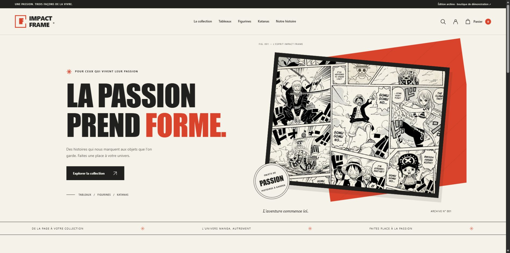

# Impact Frame — Édition archive

Une boutique manga autour de **One Piece**, restaurée pour conserver une version complète du projet : tableaux, figurines et katanas.

**Démonstration uniquement : aucun paiement, aucune vente, aucune expédition.** Le catalogue et les prix ont été reconstitués, la base de données initiale n'étant pas disponible.

## Ouvrir le site

Télécharger ou cloner ce dépôt, puis ouvrir **index.html à la racine** dans un navigateur récent. Toutes les ressources sont incluses : aucune installation, base de données ou exécution PHP n'est nécessaire.

Le dossier Impact-Frame/ contient une redirection pour préserver les anciens liens. La version active est à la racine.

Avec Node.js 18 ou plus récent, un aperçu HTTP facultatif est disponible : lancer `npm start`, puis ouvrir http://127.0.0.1:4173. Arrêter avec Ctrl+C. Aucun paquet à installer. Le serveur écoute seulement sur cet ordinateur.

## GitHub Pages

Le site est statique et peut être servi depuis **main / (root)** : sélectionner cette source dans **Settings → Pages → Deploy from a branch**. Aucun dossier de compilation n'est requis. Un push seul ne prouve pas que GitHub Pages est activé.

## Fonctionnalités

- Identité visuelle crème, noir et rouge, adaptée aux ordinateurs et téléphones.
- Trois catégories et cinq pièces illustratives ; recherche insensible aux accents et tri.
- Fiches produits, provenance des visuels et favoris.
- Panier, quantités limitées à vingt par article et totaux calculés en centimes.
- Commandes simulées et souvenirs téléchargeables en texte.
- Carnet local avec pseudonyme facultatif et vingt dernières simulations.
- Pages histoire, questions fréquentes et crédits ; musique facultative.
- Navigation au clavier, dialogues accessibles et mouvements réduits.

## Préservation du projet initial

L'historique Git est conservé. Les fichiers d'origine sont consultables dans [la version précédant cette restauration](https://github.com/NicolasGaffe/Impact-Frame/tree/e0c50dffc7e3780226381d5915cdf1ca4510d808).

L'ancien projet dépendait d'une base MySQL absente et contenait plusieurs liens cassés ainsi qu'un panier manquant. Cette édition termine le parcours en une archive autonome. Les anciens fichiers PHP ne sont plus servis dans la version active. L'archive ZIP livrée séparément conserve également les dix-huit fichiers reçus à l'identique.

## Données locales et catalogue

Les noms, prix et présentations sont illustratifs. Les tableaux utilisent les images d'origine ; Shusui reprend la photographie produit fournie. La figurine Luffy est un visuel concept généré pour la démonstration.

Le panier, les favoris, le pseudonyme et les simulations sont conservés dans ce navigateur, sous la clé impact-frame-archive-v1. Aucune donnée n'est envoyée à un serveur ; aucun compte distant, mot de passe ou renseignement bancaire n'est demandé. **Mon carnet → Effacer mon carnet → Confirmer l'effacement** remet la visite à zéro.

Si le stockage est bloqué, le site reste utilisable en mémoire pendant la visite. Le stockage en ouverture directe dépend du navigateur. Le carnet ne fait pas partie des fichiers du dépôt : le souvenir téléchargeable permet de conserver une sélection séparément.

## Modifier et vérifier

Le catalogue est dans `data.js` (prix en centimes : 4900 = 49,00 €), l'affichage dans `app.js`, les styles dans `style.css` et la sauvegarde dans `store.js`. Les ressources sont dans `assets/`.

Avec Node.js : **npm test**. Huit tests couvrent quantités, totaux, persistance, données corrompues, stockage bloqué, historique et synchronisation entre onglets. Voir [les vérifications et leurs limites](VERIFICATIONS.md).

## Crédits

Voir [la provenance des ressources](CREDITS.md), dont le prompt du visuel ajouté avec ImageGen. Le crédit visible zzyzzyy.deviantart.com est conservé. One Piece, ses personnages, les images et la musique appartiennent à leurs ayants droit. Cette restauration ne constitue pas une autorisation d'exploitation commerciale des ressources préexistantes.
